<div align="center">


# Material You AOSP Messages

**A Material You SMS & MMS app for AOSP-based Android ROMs, designed to sit right next to the AOSP / Material You Dialer.**

Big two-line headers, pill search, grouped cards, a floating pill navigation bar and wallpaper colours — built with Jetpack Compose.

[**⬇ Download the latest APK**](https://github.com/vigneshvicky2/material-you-aosp-messages/releases/latest)


</div>

> All screenshots use the built-in **screenshot mode** (made-up contacts and messages). No real data is shown.

## Screenshots

| Chats | Conversation | Updates & OTP |
|:---:|:---:|:---:|
| 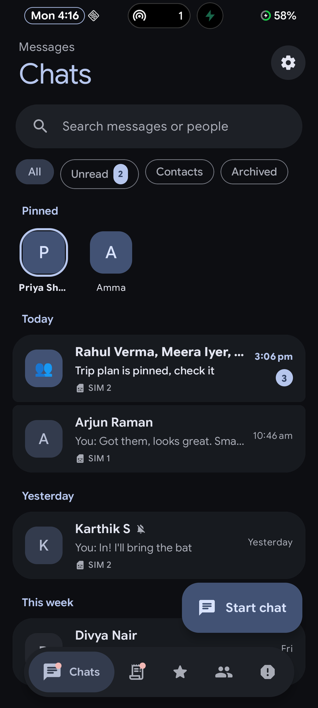 | 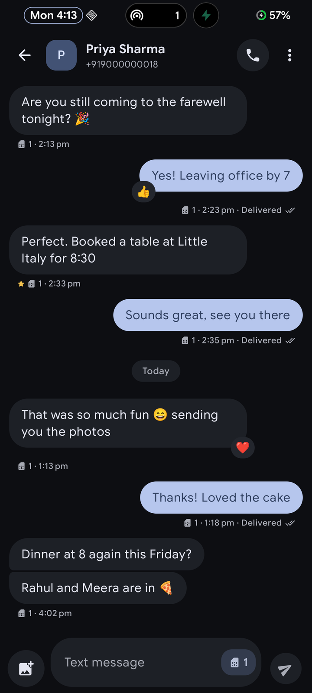 | 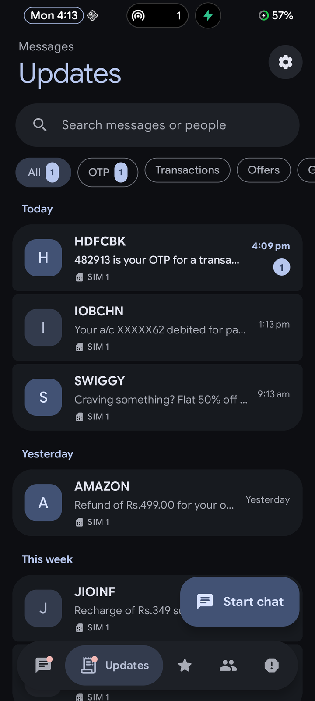 |
| **OTP copy chip** | **Reactions & actions** | **Notifications** |
| 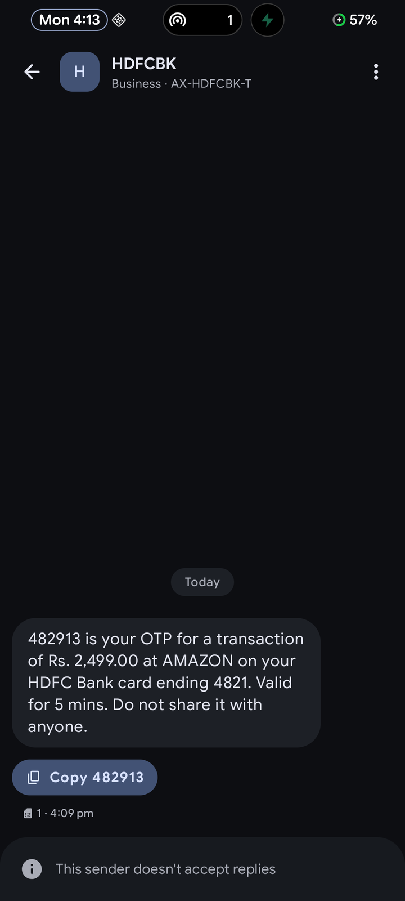 | 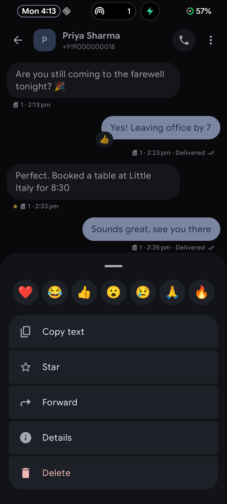 | 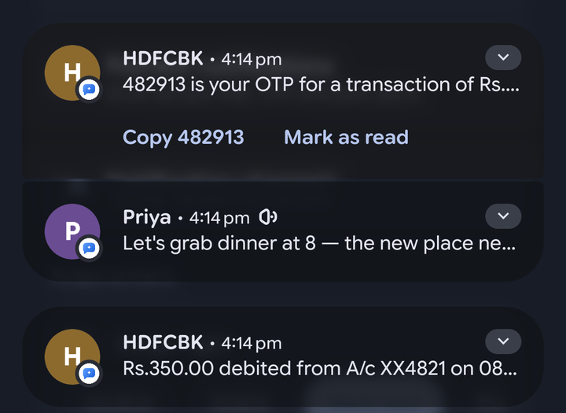 |
| **New chat** | **Search** | **Settings** |
| 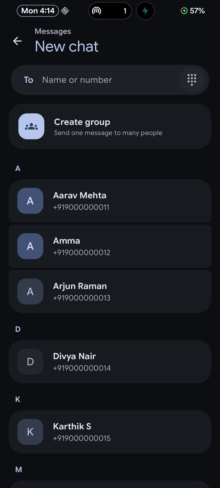 | 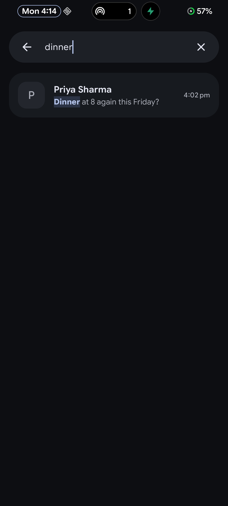 | 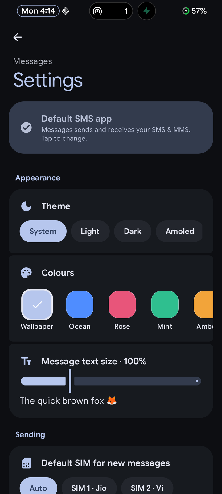 |
| **Group chat & dual SIM** | **Spam protection** | **Light theme** |
| 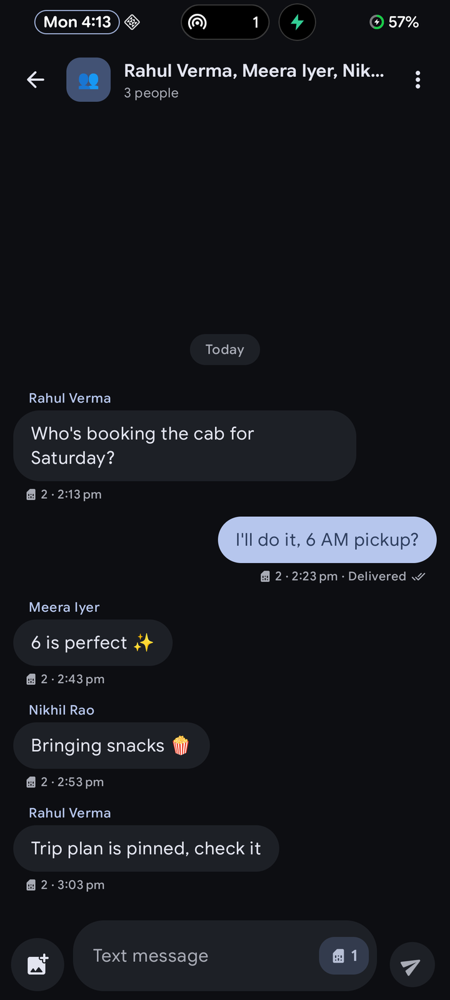 | 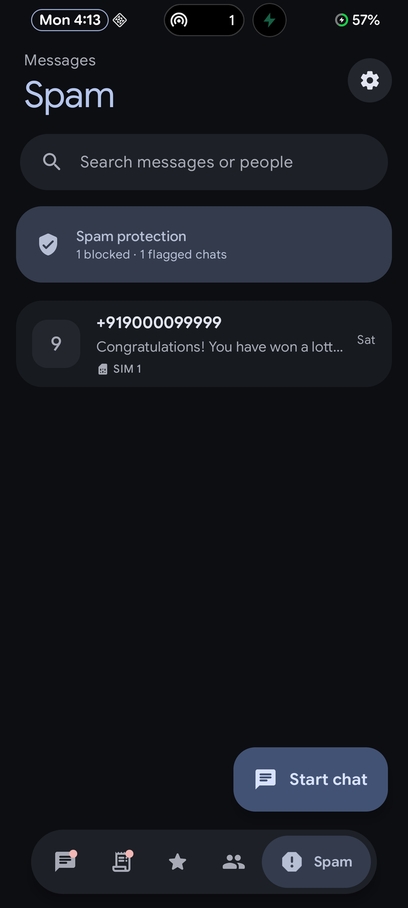 | 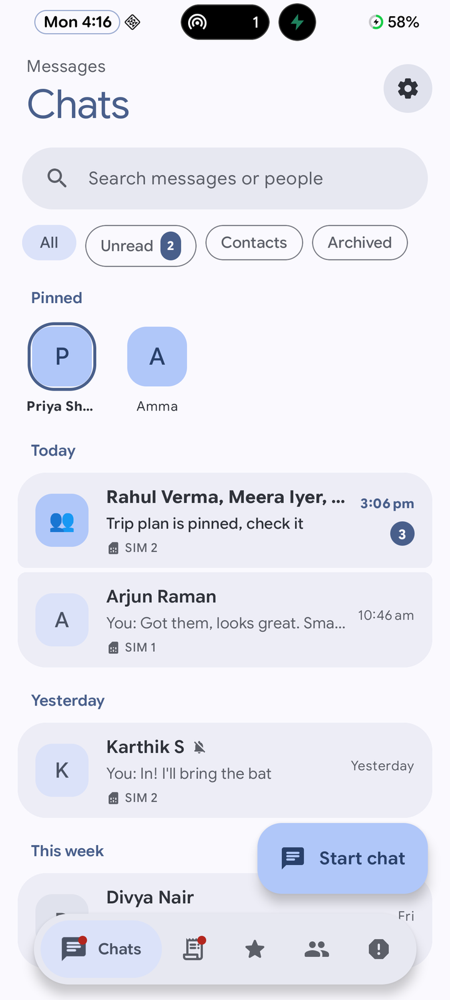 |

## Features

**Messaging**
- Full default-SMS-app support: send & receive **SMS and MMS** (photos), delivery reports, tap-to-retry on failure
- **Dual SIM**: per-conversation SIM chip in the composer, SIM badges on every message
- **Scheduled send** — hold the send button (presets or pick a date & time)
- Group messages, links and phone numbers are tappable, character / SMS-segment counter
- Quick reply from the phone app's "Respond via message"

**Smart inbox**
- **Chats** for people, **Updates** for business senders, split into **OTP · Transactions · Offers · Govt** using Indian TRAI DLT sender IDs (`-S/-T/-P/-G`)
- **Starred** messages, **Contacts** and a **Spam** folder backed by Android's blocked-numbers list
- Pin, archive, mute, block, mark read/unread, configurable **swipe actions**
- Search across names, numbers and message text with highlighted matches

**OTP helpers**
- One-tap **Copy OTP** chip on OTP messages and in notifications
- Optional **auto-copy**: new codes go to the clipboard (marked sensitive), so your keyboard offers a one-tap paste

**Notifications**
- Conversation-style notifications with avatars, **inline reply**, **mark as read**, **chat bubbles**
- Separate channels: personal/OTP alerts vs. quieter "Updates & offers"

**Design**
- Matches the Material You Dialer: two-line header, pill search, filter chips, grouped cards, squircle avatars, floating pill nav
- **Wallpaper colours** (Material You) or 5 palettes, **System / Light / Dark / AMOLED** themes, adjustable message text size
- Animations everywhere: spring bubbles, shared-element transitions, animated chips, nav bar and FAB

**Data**
- Messages stay in Android's own SMS/MMS storage — switch back to any other SMS app at any time
- **Backup & restore** all SMS plus app settings (pins, stars, reactions) as JSON
- No internet use, no analytics, no ads

## Install

1. Download `material-you-messages-vX.Y.Z.apk` from [Releases](https://github.com/vigneshvicky2/material-you-aosp-messages/releases/latest).
2. Install it (allow installs from your browser / file manager if Android asks).
3. Open **Messages** → tap **Set** on the banner to make it the default SMS app.

Requires **Android 12 (API 31)** or newer. Developed and tested on Android 16 (AOSP-based custom ROM). Works on any Android 12+ device.
Each release lists the APK's SHA-256 and the signing certificate fingerprint so you can verify the download.

---

## For developers

### Requirements

| Tool | Version |
|---|---|
| JDK | 17 or newer (built with JDK 23) |
| Android SDK | Platform 36, Build-Tools 36.0.0 |
| Gradle | 8.14 (wrapper included) |
| Android Gradle Plugin | 8.13.0 |
| Kotlin | 2.2.20 (Compose compiler plugin) |
| Compose BOM | 2025.08.00 |

Android Studio (latest stable) works out of the box. Command-line only is fine too.

### Build

```bash
git clone https://github.com/vigneshvicky2/material-you-aosp-messages.git
cd material-you-aosp-messages

# Tell Gradle where the SDK is (or open the project once in Android Studio)
echo "sdk.dir=/path/to/Android/Sdk" > local.properties        # Windows: sdk.dir=C\:/Users/<you>/AppData/Local/Android/Sdk

./gradlew assembleDebug        # app/build/outputs/apk/debug/app-debug.apk   (package io.github.vigneshvicky2.messages.debug)
./gradlew assembleRelease      # app/build/outputs/apk/release/app-release.apk (R8-minified, ~3 MB)
```

Install on a connected device:

```bash
adb install -r app/build/outputs/apk/debug/app-debug.apk
```

The **debug** build uses the package `io.github.vigneshvicky2.messages.debug`, so it installs **next to** the release app and never touches your real install. To test sending/receiving with it, make the debug app the default SMS app (Settings → Apps → Default apps → SMS).

### Command-line SDK setup (no Android Studio)

```bash
# Download "Command line tools only" from developer.android.com/studio and unzip to <sdk>/cmdline-tools/latest
<sdk>/cmdline-tools/latest/bin/sdkmanager --sdk_root=<sdk> --licenses
<sdk>/cmdline-tools/latest/bin/sdkmanager --sdk_root=<sdk> "platforms;android-36" "build-tools;36.0.0" "platform-tools"
```

On Windows with a newer JDK, `sdkmanager.bat` may wrongly report "Java 17 or higher is required"; set `SKIP_JDK_VERSION_CHECK=1` to work around it.

### Release signing

Release builds look for a signing config **outside the repository**:

- `MESSAGES_SIGNING` environment variable pointing to a `.properties` file, or
- `~/.android-keys/material-you-messages.properties` (default)

```properties
storeFile=/absolute/path/to/your-release-key.jks
storePassword=...
keyAlias=...
keyPassword=...
```

Create a key with:

```bash
keytool -genkeypair -v -keystore my-release.jks -alias messages -keyalg RSA -keysize 4096 -validity 10000
```

If no signing file is found, release builds fall back to your local debug key so the project always builds. **Never commit keystores or passwords** — `*.jks`, `*.keystore` and `local.properties` are git-ignored.

### Screenshot mode (debug builds only)

Fills the app with realistic made-up conversations, contacts and two SIMs, and turns every write (send, delete, mark read, block) into a no-op — useful for screenshots, demos and UI work without a SIM.

```bash
# on
adb shell am start -n io.github.vigneshvicky2.messages.debug/io.github.vigneshvicky2.messages.MainActivity --ez demo true
# off
adb shell am start -n io.github.vigneshvicky2.messages.debug/io.github.vigneshvicky2.messages.MainActivity --ez demo false
```

Sample notifications: **Settings → Notifications → Preview notifications**. Demo data lives in [`data/Demo.kt`](app/src/main/java/io/github/vigneshvicky2/messages/data/Demo.kt). Release builds ignore the flag entirely.

### Project structure

```
app/src/main/java/io/github/vigneshvicky2/messages/
├── MainActivity.kt          Navigation (Compose NavHost + shared-element transitions), intents (sms:, share), role request
├── BubbleActivity.kt        Compact conversation shown inside a notification bubble
├── MessagesApp.kt           Application: notification channels, screenshot-mode init
├── data/
│   ├── SmsRepo.kt           Reads/writes the Telephony provider: threads, SMS, MMS parts, search, blocking
│   ├── ContactsRepo.kt      Contact lookup (cached) + SimRepo (active subscriptions)
│   ├── Classifier.kt        Personal / OTP / transaction / offer / govt / spam classification, OTP extraction
│   ├── Prefs.kt             App-only metadata: pins, archive, mute, stars, reactions, drafts, scheduled, settings
│   ├── Backup.kt            JSON export / import
│   ├── Demo.kt              Screenshot mode data (debug only)
│   └── Models.kt            Conversation, Message, Contact, SimInfo, …
├── sms/
│   ├── SmsSender.kt         Sending (multipart, dual SIM, sent/delivered tracking), SMS_DELIVER receiver,
│   │                        respond-via-message service, scheduled send (AlarmManager), boot re-arm
│   ├── Mms.kt               MMS send / download / persist via SmsManager + FileProvider
│   └── Pdu.kt               Minimal OMA MMS (WAP binary) encoder/decoder: m-send-req, m-notification-ind, m-retrieve-conf
├── notify/Notifier.kt       MessagingStyle notifications, shortcuts, bubbles, reply / mark-read / copy-OTP actions
└── ui/
    ├── theme/Theme.kt       Material You / seeded palettes, AMOLED, typography, avatar colours
    ├── components/          Dialer-style building blocks: BigHeader, SearchPill, ChipRow, PillNavBar, Avatar, …
    ├── home/                Tabs (Chats, Updates, Starred, Contacts, Spam), conversation cards, swipe actions, search
    ├── thread/              Conversation screen: bubbles, reactions, OTP chip, composer, SIM switch, scheduling
    ├── newchat/             Recipient picker (contacts, numbers, groups)
    ├── settings/            Settings screen
    └── ViewModels.kt        MainViewModel, ThreadViewModel (StateFlow, ContentObserver-driven refresh)
```

### How it works

- **Default SMS role.** The manifest declares everything Android requires of an SMS app: an `SMS_DELIVER` receiver, a `WAP_PUSH_DELIVER` receiver for MMS, a `RESPOND_VIA_MESSAGE` service and `sms:/smsto:/mms:/mmsto:` intent filters. The app asks for the role with `RoleManager.createRequestRoleIntent(ROLE_SMS)`.
- **Storage.** As the default app, Messages writes incoming and outgoing SMS/MMS into the system Telephony provider itself, so every other SMS app still sees the same history. Features Android has no columns for (pins, stars, reactions, scheduled messages) live in `Prefs`.
- **Live updates.** Screens observe `content://mms-sms/` with a `ContentObserver` and reload through `StateFlow`s.
- **MMS.** Outgoing MMS are encoded as `m-send-req` PDUs and handed to `SmsManager.sendMultimediaMessage` through a `FileProvider` URI; incoming notifications are downloaded with `downloadMultimediaMessage`, parsed and persisted with their parts.
- **Classification.** `Classifier` uses DLT sender suffixes plus keyword rules to sort business messages, and a proximity-based regex to pull OTPs out of message text.

### Testing checklist

There are no automated UI tests yet. Before a release, check on a real device with a SIM:

- [ ] Set as default SMS app; existing conversations appear
- [ ] Send / receive SMS on each SIM; delivery report updates to "Delivered"
- [ ] Long message shows the segment counter and arrives intact
- [ ] Send / receive an MMS photo
- [ ] Notification: inline reply sends, mark as read clears, OTP copy works
- [ ] Scheduled message sends at the chosen time (also after reboot)
- [ ] Block a number; its messages stop arriving
- [ ] Backup → restore skips duplicates

### Contributing

1. Fork, then create a branch: `git checkout -b feature/my-change`
2. Keep the Dialer-matched look: reuse `ui/components` and the theme tokens instead of hard-coded colours/sizes
3. Build both variants (`assembleDebug`, `assembleRelease`) and run through the relevant checklist items
4. Open a pull request with screenshots (screenshot mode helps)

### Known limitations

- **No RCS** — RCS chat is only available to Google Messages.
- MMS has been exercised less than SMS; carrier-specific MMS settings (APN quirks) may need work.
- Reactions and stars are local to this app; the other person does not see them.

---

<div align="center">
Made for the <b>Material You</b> AOSP experience.
</div>
